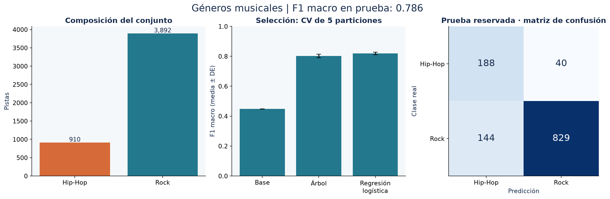

# Clasificación de Rock y Hip-Hop mediante características de audio

**Autor:** Hector Americo Torres Huamani · [Repositorio](https://github.com/hectortorres26/clasificacion-generos-musicales) · [Cuaderno ejecutado](clasificador_canciones.ipynb)

Clasificar pistas de Rock y Hip-Hop a partir de ocho características acústicas. El objetivo es evaluar una clasificación reproducible que tenga en cuenta el desequilibrio de clases, con una prueba independiente de la selección del modelo.



## Resultados verificados

| Métrica en prueba (1.201 pistas) | Regresión logística | Referencia mayoritaria |
|---|---:|---:|
| F1 macro | 0,786 | 0,448 |
| Exactitud | 84,68 % | 81,02 % |
| Exactitud balanceada | 83,83 % | 50,00 % |
| Recall de Hip-Hop | 82,46 % | 0,00 % |

F1 macro en validación cruzada: **0,819 ± 0,008** (media ± desviación entre cinco particiones). Intervalo bootstrap del 95 % para F1 macro en prueba: **0,758–0,812**. PCA conserva siete componentes, que explican el 95,25 % de la varianza del entrenamiento.

La exactitud aislada ocultaría el fallo de la referencia, que predice siempre Rock. F1 macro pondera por igual ambos géneros. La regresión logística detecta 188 de las 228 pistas Hip-Hop de prueba, pero también etiqueta como Hip-Hop 144 pistas Rock: la precisión de Hip-Hop es 56,63 %. Este coste debe considerarse antes de usar el clasificador para etiquetar un catálogo.

Las cifras proceden de [reports/metrics.json](reports/metrics.json). El cuaderno regenera tablas y figuras desde los datos; no introduce métricas manualmente en el código.

## Herramientas y metodología

Python, pandas, NumPy y Matplotlib, con pruebas `unittest` y cuadernos ejecutados mediante nbclient. Scikit-learn aporta los pipelines, los modelos y la validación.

1. Validar los dos archivos y unirlos por `track_id` con relación uno a uno. Rechazar identificadores duplicados, infinitos y características completamente ausentes. Comprobar duplicados exactos de las ocho características.
2. Conservar 4.802 pistas: 3.892 Rock y 910 Hip-Hop. Reservar el 25 % mediante una división estratificada, con semilla 42.
3. Ajustar imputación por mediana, `StandardScaler` y PCA (95 % de varianza) dentro de cada pipeline y de cada partición de entrenamiento.
4. Comparar referencia mayoritaria, árbol con pesos balanceados y regresión logística con pesos balanceados mediante cinco particiones estratificadas del entrenamiento. Los hiperparámetros están fijados en el código; no se afirma una búsqueda exhaustiva.
5. Seleccionar por F1 macro medio de validación y evaluar el modelo seleccionado y la referencia en el mismo conjunto de prueba. No equilibrar artificialmente la prueba.
6. Estimar un intervalo de F1 macro con 500 remuestreos de las predicciones de prueba, manteniendo el modelo fijo.

## Datos y procedencia

Origen del proyecto: [Free Music Archive (FMA)](https://github.com/mdeff/fma). Para esta ejecución se usó la [copia pública del material de DataCamp](https://github.com/veeralakrishna/DataCamp-Project-Solutions-Python/tree/master/Classify%20Song%20Genres%20from%20Audio%20Data/datasets). Descarga `fma-rock-vs-hiphop.csv`, renómbralo `songs.csv` y descarga `echonest-metrics.json`; coloca ambos en `data/`. La copia consultada contiene 17.734 filas de pistas y 13.129 filas de métricas, antes de la unión y el filtro.

Los resultados publicados se ejecutaron con copias públicas descargadas de las fuentes indicadas. No se ha verificado identidad byte a byte con los archivos del Drive del autor. Las huellas SHA-256 en [data/README.md](data/README.md) y `reports/metrics.json` identifican las entradas exactas. Los datasets se excluyen de Git; consulta las condiciones de cada fuente antes de reutilizarlos o redistribuirlos.

| Campo | Uso |
|---|---|
| `track_id` | Clave de unión; nunca predictor |
| `genre_top` | Etiqueta objetivo: Rock o Hip-Hop |
| `acousticness`, `instrumentalness` | Características acústicas e instrumentales |
| `danceability`, `energy`, `valence` | Descriptores musicales |
| `liveness`, `speechiness`, `tempo` | Descriptores de directo, voz hablada y tempo |

Los ocho predictores se utilizan como mediciones provistas por Echonest; este proyecto no extrae características directamente de archivos de audio.

## Reproducir el proyecto

```powershell
git clone https://github.com/hectortorres26/clasificacion-generos-musicales.git
cd clasificacion-generos-musicales
python -m venv .venv
.\.venv\Scripts\python.exe -m pip install -r requirements.txt
# Coloca los archivos descritos en «Datos y procedencia» dentro de data/.
.\.venv\Scripts\python.exe -m unittest discover -s tests -v
.\.venv\Scripts\python.exe -m src.analysis
.\.venv\Scripts\python.exe scripts/execute_notebook.py
```

En macOS/Linux utiliza `.venv/bin/python` en lugar de `.\.venv\Scripts\python.exe`.
La ejecución validada utiliza Python 3.11.9; las versiones están fijadas en `requirements.txt`.
`python -m src.analysis --help` permite cambiar rutas de entrada y salida.
El último comando ejecuta el cuaderno en un kernel nuevo y guarda sus salidas; no requiere instalar la interfaz de Jupyter.
Para explorarlo interactivamente, abre el archivo `.ipynb` en VS Code con soporte de Jupyter y selecciona el entorno `.venv`.


## Estructura

| Ruta | Contenido |
|---|---|
| `clasificador_canciones.ipynb` | Problema, metodología, ejecución y conclusiones |
| `src/analysis.py` | Validación, análisis y generación de resultados |
| `src/common.py` | Estilo visual, serialización y trazabilidad |
| `tests/test_analysis.py` | Regresiones de los fallos técnicos corregidos |
| `data/README.md` | Entradas requeridas y huellas SHA-256 |
| `reports/` | Métricas JSON, tablas agregadas CSV y figuras PNG |
| `scripts/execute_notebook.py` | Ejecución reproducible con kernel limpio |
| `DESCRIPCION_PORTAFOLIO.md` | Texto profesional listo para el portafolio |

## Alcance y limitaciones

Solo se cubren dos géneros y una colección concreta. La división es por pista: no garantiza separación por artista o álbum porque esos identificadores no forman parte de las entradas utilizadas. El intervalo bootstrap no incorpora incertidumbre del entrenamiento y puede ser optimista si las pistas están relacionadas. No se ha validado audio nuevo, otros géneros ni cambios de distribución. Las métricas antiguas no son directamente comparables porque cambió el protocolo de evaluación; no se afirma haber eliminado todo sesgo.

## Historial y correcciones

El [archivo de la versión inicial](https://github.com/hectortorres26/clasificacion-generos-musicales/blob/4dffafd3f5e8f511ca13eded6ec59a2362b12e84/clasificador_canciones.ipynb) permanece en el historial.
Los cambios se registran en commits separados para código, cuaderno/resultados y documentación, sin reescribir la versión inicial.
Consulta [CHANGELOG.md](CHANGELOG.md) para relacionar los problemas originales con las correcciones.

Referencia metodológica: [prevención de fuga de información en scikit-learn](https://scikit-learn.org/stable/common_pitfalls.html).
